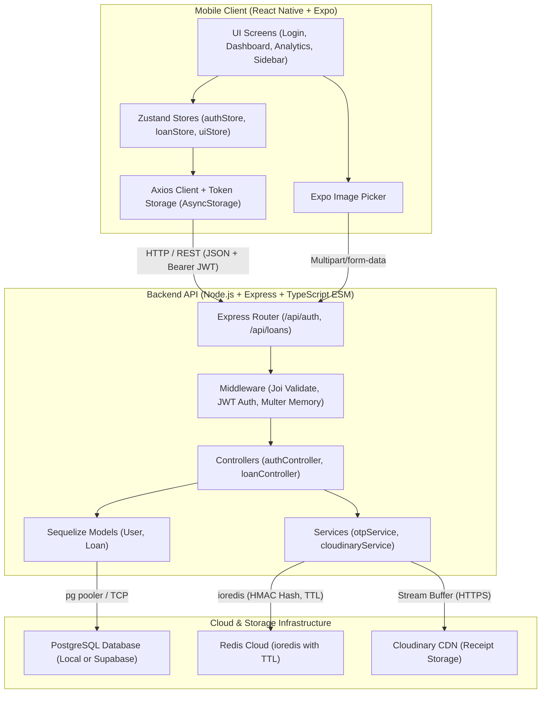
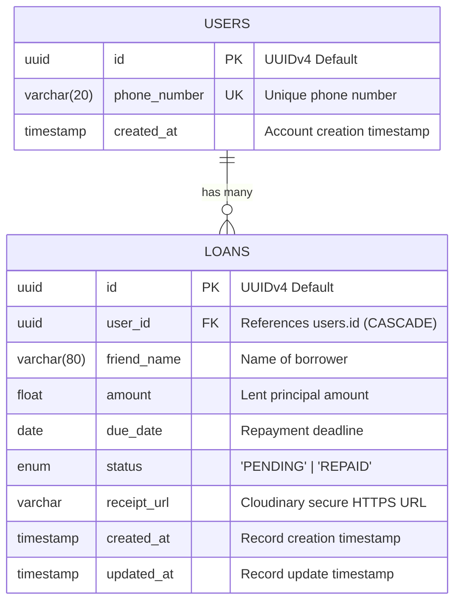
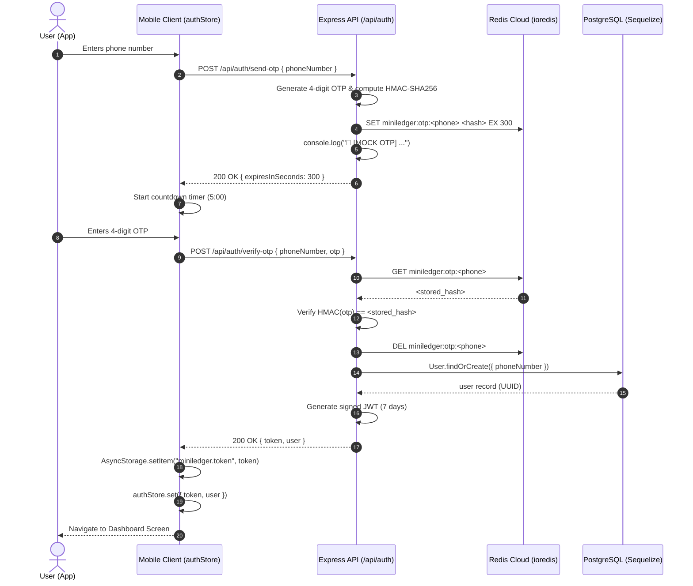
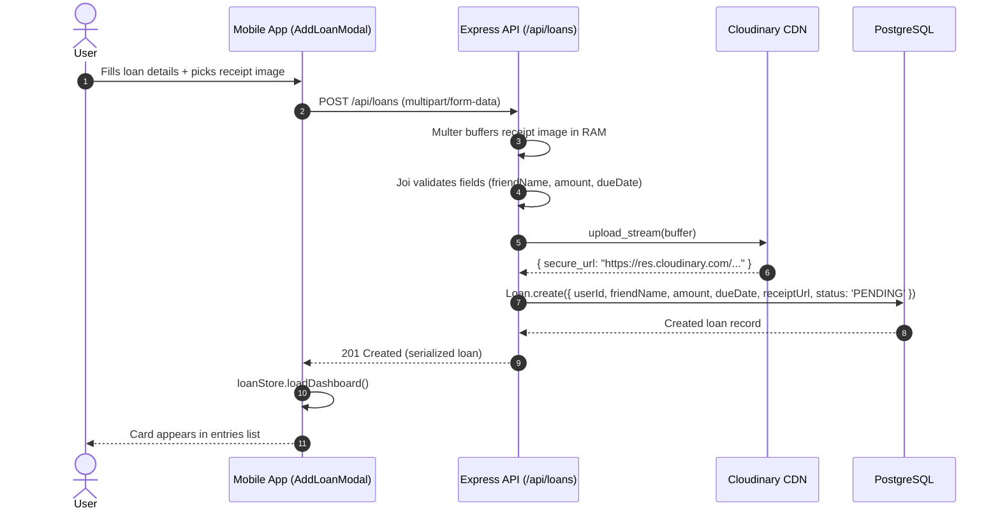
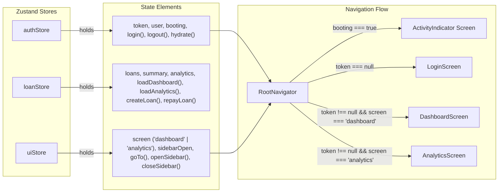

# MiniLedger Technical Architecture Document

## 1. Executive Summary

**MiniLedger** is a full-stack, production-ready ledger application designed for tracking personal loans between friends. It enforces strong data integrity, resilient authentication, and a clean modern mobile user experience adhering strictly to a curated 5-color dark palette.

### Key Architectural Tenets
- **Backend**: Node.js, TypeScript, Pure ESM (`"type": "module"`), Express.js, Sequelize ORM with PostgreSQL.
- **Cache & Auth Session**: Redis Cloud (accessed via `ioredis`) for cryptographically hashed OTP storage with automated TTL expiration and countdown tracking.
- **Media Ingestion**: Multer memory streaming to Cloudinary free CDN for receipt attachments.
- **Mobile Frontend**: React Native with Expo, TypeScript, and unified Zustand state management (`authStore`, `loanStore`, `uiStore`).
- **Design System**: Strict 5-color dark theme (`#1A1A1A`, `#222526`, `#363A3E`, `#E0E0E0`, `#BFBFBF`) with clean, modern sans typography.

---

## 2. System Architecture & Component Diagram

---

## 3. Database Schema & Data Models

MiniLedger uses PostgreSQL via Sequelize ORM with UUID primary keys and standard foreign key relations.

### 3.1 Entity Relationship Diagram

### 3.2 Dual Database Strategy
The backend accommodates two connection strategies via environment variables:
1. **Local PostgreSQL**: Configured with `DB_HOST`, `DB_PORT`, `DB_USER`, `DB_PASSWORD`, `DB_NAME`, `DB_SSL=false`.
2. **Supabase Managed Postgres / Connection Pooler**: Configured with pooler host or direct connection string with `DB_SSL=true`.
3. Alternatively, `DATABASE_URL` takes precedence when provided.

---

## 4. Authentication & OTP Lifecycle Architecture

Authentication is passwordless and phone-number based with security precautions:
1. **Zero Plaintext OTP Persistence**: The generated 4-digit mock OTP is **never** stored plaintext in memory or cache. It is hashed using HMAC-SHA256 with a server secret (`OTP_HASH_SECRET`).
2. **Redis Cloud Expiration (TTL)**: The hashed OTP is stored in Redis Cloud with a key `miniledger:otp:<phoneNumber>` and an explicit TTL (default 300 seconds / 5 minutes).
3. **Mock Server Log Output**: To satisfy assessment requirements, the plaintext OTP is logged to the server console: `🔑 [MOCK OTP] For <phoneNumber>: <otp>`.
4. **Rate Limiting & Resend Prevention**: When an OTP is re-requested, the existing key is purged and overwritten with the new hashed code and refreshed TTL.
5. **Session Invalidation**: When verified, the OTP key is immediately deleted from Redis Cloud (`single-use token`).

### 4.1 OTP Sequence Diagram

---

## 5. Loan Lifecycle & Cloudinary Receipt Upload

Receipt photos are attached directly during loan creation:
1. **Mobile Selection**: `expo-image-picker` selects or captures an image and generates a local file URI.
2. **Multipart Submission**: App submits a `multipart/form-data` payload containing `friendName`, `amount`, `dueDate`, and `receipt` (file binary).
3. **Streaming Ingestion**: Multer uses in-memory storage (`multer.memoryStorage()`) with a 5MB payload limit and image MIME-type filter.
4. **Cloudinary Pipeline**: The memory buffer streams to Cloudinary's Upload API asynchronously without writing temporary files to local disk.
5. **Persistence**: Cloudinary returns a secure HTTPS CDN URL (`secure_url`), which Sequelize saves in `loans.receipt_url`.

### 5.1 Loan Creation Diagram

---

## 6. Frontend State Management & Navigation Architecture

The frontend avoids context overhead by utilizing dedicated **Zustand stores**:

---

## 7. Modern Fintech Design System & Sora Typography

The mobile interface is styled with a modern fintech palette based on three curated colors:
- **`#CEFEF1` (Mint Ice)**: Luminous high-contrast text, major monetary figures, active highlights.
- **`#A6D6C9` (Soft Sage)**: Subtitles, field labels, metadata, subtle borders, and secondary buttons.
- **`#4CA7A1` (Ocean Teal)**: Primary CTA buttons, active navigation chips, accent borders, progress indicators.
- **`#0B1211` / `#121C1B` / `#182624`**: Deep obsidian-teal layered dark backgrounds harmonized with the teal palette.

### Typography (Sora)
- Integrated via `@expo-google-fonts/sora`:
  - `Sora_400Regular`: Clean input fields, body text, and subtitles.
  - `Sora_500Medium`: Form labels, button text, and timestamps.
  - `Sora_600SemiBold`: Card titles, badges, and section headers.
  - `Sora_700Bold`: Main screen titles, brand kicker, and total balances.

---

## 8. Summary Metrics & Analytics Computation Engine

### Real-Time Metric Definitions
- **Total Lent**: Sum of all active/pending loan amounts:
  $$\text{totalLent} = \sum_{i \in \text{PENDING}} \text{amount}_i$$
- **Total Repaid**: Sum of all settled loan amounts:
  $$\text{totalRepaid} = \sum_{j \in \text{REPAID}} \text{amount}_j$$
- **Overdue Amount**: Sum of amounts where payment has lapsed:
  $$\text{overdueAmount} = \sum_{k \in \text{PENDING}, \text{dueDate}_k < \text{today}} \text{amount}_k$$

### Analytics Engine (`/api/loans/analytics`)
- Aggregates overall volume and status counts (`total`, `pending`, `repaid`, `overdue`).
- Calculates 6-month monthly trends comparing money lent vs repaid.
- Groups and ranks top borrowers by outstanding loan amount.
